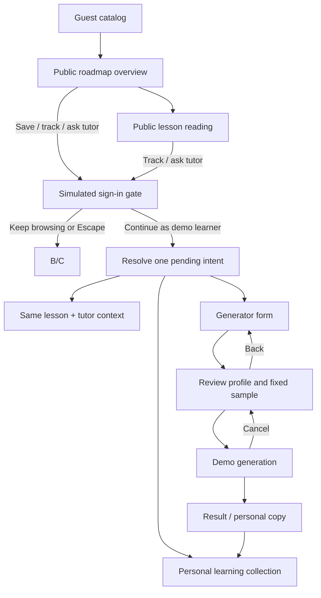

# Learning studio prototype: backend handoff

This document describes the local prototype flow and a proposed production boundary. Existing endpoints below were checked against `apps/api/src/routers/roadmap_jobs.py`, `curriculum.py`, `auth.py`, `main.py`, and `dependencies.py`. Proposed routes and fields are design suggestions, not implemented contracts.

## User journey and state ownership



| Entity                             | Owner and identity                                                            | Mutation boundary                                                                                                                                                                      |
| ---------------------------------- | ----------------------------------------------------------------------------- | -------------------------------------------------------------------------------------------------------------------------------------------------------------------------------------- |
| Published roadmap template         | Public; `templateId + snapshotVersion`                                        | Immutable after publication; lesson IDs are stable within the snapshot.                                                                                                                |
| Public lesson                      | Public; `templateId + snapshotVersion + topicId`                              | Read-only. Guests can read any seeded lesson without an account.                                                                                                                       |
| Enrollment / personal roadmap copy | Learner workspace; `workspaceId + roadmapId + revisionId + sourceSnapshotRef` | Save creates or returns one private copy; it never mutates the public template. A generated copy retains the selected sample as its source reference and stores its own profile/title. |
| Topic progress                     | Enrollment/revision + topic                                                   | Learner-owned completion intent. Completion is separate from knowledge-check evidence or mastery.                                                                                      |
| Conversation                       | Enrollment + topic + session ID                                               | Private learner content. Topic switches do not reassign messages, drafts, quotes, or reading position.                                                                                 |
| Generator job                      | Authenticated owner + idempotency key                                         | Job status is private. A cancelled or stale job must not publish a copy later.                                                                                                         |
| Source reference                   | Published lesson/topic                                                        | Public metadata may expose vetted reference title, URL, locator, and attribution; private uploads and conversation data are never attached to it.                                      |

## Access matrix

| Action                                                                           | Guest                                                                   | Signed-in learner                                                      |
| -------------------------------------------------------------------------------- | ----------------------------------------------------------------------- | ---------------------------------------------------------------------- |
| Browse/search/filter public catalog                                              | Allowed                                                                 | Allowed                                                                |
| Read published roadmap, outcomes, prerequisites, lesson, public source reference | Allowed                                                                 | Allowed                                                                |
| Save a template to My learning                                                   | Gate, then execute after sign-in                                        | Create or return existing enrollment copy                              |
| Track lesson completion                                                          | Gate, then execute after sign-in                                        | Update enrollment topic progress                                       |
| Ask tutor / create conversation                                                  | Gate with topic, quote, and return location, then execute after sign-in | Open or create a topic session                                         |
| Create a roadmap                                                                 | Gate, then open generator after sign-in                                 | Submit profile, review, and create from selected template              |
| Read learner collection, progress, or conversation history                       | Never                                                                   | Only within the authorized workspace/enrollment                        |
| Cancel a generation job                                                          | Not applicable                                                          | Cancel only an owned active job; a late event cannot publish a roadmap |

The UI's simulated login intentionally collects no credentials. Production must use the existing authentication system and authorize every private operation server-side. A sanitized `PublicJobSnapshot` from the current roadmap-job flow is still a private job response; it is not public catalog access.

## Existing backend building blocks

The API currently provides these relevant routes under `/api/v1`:

- `POST /roadmap/jobs` accepts `RoadmapRequest` and requires a UUID `Idempotency-Key`.
- `GET /roadmap/jobs`, `GET /roadmap/jobs/{jobId}`, `GET /roadmap/jobs/{jobId}/events` inspect the caller's jobs; job actions include `POST /roadmap/jobs/{jobId}/start`, `/cancel`, `/retry`, and `/answers`.
- `GET /workspaces` lists accessible workspaces; there is no dedicated signed-in roadmap collection endpoint today.
- `GET /workspaces/{workspaceId}/roadmap`, `GET /workspaces/{workspaceId}/roadmap/topics/{topicId}`, and `PATCH /workspaces/{workspaceId}/roadmap/topics/{topicId}/progress` read/update a workspace roadmap and topic progress.
- `POST /workspaces/{workspaceId}/roadmap/topics/{topicId}/sessions` creates a topic session with a UUID `Idempotency-Key`; `GET` on the same path lists sessions, and `GET .../sessions/{sessionId}` fetches one session.
- `POST /workspaces/{workspaceId}/roadmap/topics/{topicId}/checks` submits a knowledge check.
- `POST /chat/stream` streams a chat response.
- Auth routes include register, login, Google login, refresh, logout, and `GET /auth/me`.

The existing `RoadmapRequest` fields are `title`, `prompt`, `level`, `background`, `duration`, and `hoursPerWeek`. Existing duration is a value plus `weeks` or `months`. The prototype's level (`Beginner`/`Intermediate`/`Advanced` maps to `beginner`/`intermediate`/`advanced`), title, prompt, background, and weekly hours map directly. Its numeric duration-in-weeks maps to `{value, unit: "weeks"}`. The outcome, known skills, and optional reference URL are additional proposed inputs; they are not represented by the current request contract. The prototype's explicit fixed sample selection is also not a claim that the current job endpoint accepts or honors a template ID.

## Proposed public and enrollment contracts

The following are proposed additions, not existing endpoints:

| Proposed endpoint                                                    | Purpose                                                                                |
| -------------------------------------------------------------------- | -------------------------------------------------------------------------------------- |
| `GET /api/v1/public/roadmaps?query=&category=&level=`                | Search/filter published catalog; returns only public template metadata.                |
| `GET /api/v1/public/roadmaps/{slug}`                                 | Fetch a published snapshot, outcomes, prerequisites, phases, estimate, and references. |
| `GET /api/v1/public/roadmaps/{slug}/topics/{topicSlug}`              | Fetch read-only lesson content for guest or signed-in preview.                         |
| `GET /api/v1/workspaces/{workspaceId}/learning-roadmaps`             | Collection projection of the caller's saved/generated enrollment copies and progress.  |
| `POST /api/v1/workspaces/{workspaceId}/learning-roadmaps`            | Idempotently create a personal copy from `templateId + snapshotVersion`.               |
| `GET /api/v1/workspaces/{workspaceId}/learning-roadmaps/{roadmapId}` | Fetch one private copy with its source snapshot reference and profile.                 |

Proposed save request:

```json
{
  "templateId": "roadmap-python-backend",
  "snapshotVersion": "2026-10-14.1",
  "title": null
}
```

Use an idempotency key for save and generation so retries return the same copy. Proposed generated roadmap request extends the existing `RoadmapRequest` with `outcome`, `knownSkills`, `referenceUrl`, and an explicit `sampleTemplateRef` for this preview mode. In production, `sampleTemplateRef` must be validated and the resulting revision must preserve `sourceSnapshotRef`; the selected source remains unchanged. A request without an explicit fixed sample must use the real generation job path and report its actual job status.

A public DTO should include only public title/slug/summary/category/level/tags, outcomes, prerequisites, phase/topic ordering, estimates, lesson content, and public source metadata. It must exclude `workspaceId`, chat/session IDs, progress, personal profile, private-upload data, branch-origin references, job internals, and authorization details. An enrollment DTO may include the caller's `roadmapId`, `revisionId`, `sourceSnapshotRef`, title/profile, and per-topic progress only after workspace authorization.

## Pending sign-in intent and return behavior

The prototype stores one discriminated intent: `save(templateId)`, `complete(templateId, topicId)`, `tutor(templateId, topicId, quote?)`, `generator`, or `signin`. It retains the current public roadmap/topic and lesson reading position while the dialog is open. Dismissal performs no mutation and leaves the user at the original catalog, overview, or lesson. After successful authentication, the client resolves the intent once using the returned user/workspace context, then clears it. Generic sign-in opens learner Home while retaining the public context in local state; the local demo offers Browse roadmaps to return to public content. Save and completion calls use idempotency keys; tutor resumes the same topic and carries the selected quote as explicit context; generator opens the form. For sign-in without a pending action, return to learner Home; the user can browse public content from the learner navigation.

Treat an auth callback's intended action as untrusted input: validate the public template/topic against the current published snapshot, authorize the learner workspace, and reject expired/invalid references without applying partial state. Do not put primary workspace or roadmap identities in URL query parameters. Proposed public URLs are additive: `/learn`, `/learn/{slug}`, and `/learn/{slug}/lessons/{topicSlug}`. A signed-in collection may use `/learning`; private workspace routes remain the existing canonical `/w/{workspaceId}` hierarchy from `docs/URL_DESIGN.md`.

## Loading, empty, failure, and cancellation states

- Catalog loading: skeleton cards; empty search: explain filters and offer a working clear action; catalog failure: keep search state and offer retry.
- Public snapshot missing/unpublished: show unavailable state and return to catalog; do not silently switch to a different template.
- Enrollment save: pending state, success opens My learning, conflict returns the existing copy, and retry reuses the idempotency key.
- Auth dismissal/expiration: preserve public route and scroll; no progress/session is created.
- Generator: show job status from the job endpoint/event stream; cancellation disables later publication, retry creates/reuses an explicitly new job according to API semantics, and errors keep the review profile editable.
- Topic progress: surface saved/failed state; do not label completion as mastery.
- Tutor: loading/error is associated with the same topic session; never merge history when the active topic changes.
- Access denied: use a neutral unavailable response for private resources and keep private metadata out of public error bodies.

## Acceptance checks for backend wiring

1. Anonymous users can list published sample roadmaps and fetch any published lesson without a workspace or auth token.
2. Public reads never return enrollment progress, conversation/session history, private uploads, or job internals.
3. Saving a template creates or reuses one private copy keyed to the authenticated workspace; edits/progress affect that copy only.
4. An auth return executes the stored intent once, preserves topic/quote/return context, and is safe under duplicate callback/retry.
5. Topic progress, tutor sessions, drafts, quotes, and reading positions remain scoped to the enrollment/revision and topic.
6. Generator input round-trips current `RoadmapRequest` fields plus separately versioned proposed fields. Invalid URL, out-of-range pace, stale template, denied access, job error, and cancellation have explicit responses.
7. A cancelled/stale job cannot publish. A generated personal copy identifies its source template snapshot and carries learner-provided outcome/level/background/pace without modifying the source.
8. Public route additions do not change `/w/{workspaceId}`, `/w/{workspaceId}/chat/{chatId}`, canvas path semantics, or existing redirects.
