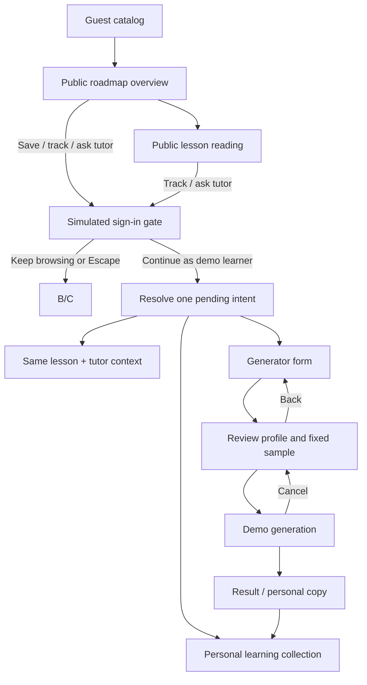

# Learning studio prototype: backend handoff

This document describes the local prototype flow and a proposed production boundary. Existing endpoints below were checked against `apps/api/src/routers/roadmap_jobs.py`, `curriculum.py`, `auth.py`, `main.py`, and `dependencies.py`. Proposed routes and fields are design suggestions, not implemented contracts.

## User journey and state ownership



| Entity                             | Owner and identity                                                            | Mutation boundary                                                                                                                                                                      |
| ---------------------------------- | ----------------------------------------------------------------------------- | -------------------------------------------------------------------------------------------------------------------------------------------------------------------------------------- |
| Published roadmap template         | Public; `templateId + snapshotVersion`                                        | Immutable after publication; lesson IDs are stable within the snapshot.                                                                                                                |
| Public lesson                      | Public; `templateId + snapshotVersion + topicId`                              | Read-only. Guests can read any seeded lesson without an account.                                                                                                                       |
| Enrollment / personal roadmap copy | Learner workspace; `workspaceId + roadmapId + revisionId + sourceSnapshotRef` | Save creates or returns one private copy; it never mutates the public template. A generated copy retains the selected sample as its source reference and stores its own profile/title. |
| Topic progress                     | Enrollment/revision + topic                                                   | Learner-owned completion intent. Completion is separate from knowledge-check evidence or mastery.                                                                                      |
| Practice attempt                   | Enrollment/revision + topic + activity version                                | Private answer, feedback, and hint state; local sample checks demonstrate interaction only. Production assessment must validate the activity and answer server-side.                   |
| Conversation                       | Enrollment + topic + session ID                                               | Private learner content. Topic switches do not reassign messages, drafts, quotes, or reading position.                                                                                 |
| Generator job                      | Authenticated owner + idempotency key                                         | Job status is private. A cancelled or stale job must not publish a copy later.                                                                                                         |
| Source reference                   | Published lesson/topic                                                        | Public metadata may expose vetted reference title, URL, locator, and attribution; private uploads and conversation data are never attached to it.                                      |

## Chats and branch boundaries

The prototype's **Chats** view is a unified presentation, not a second transcript store. Existing `enrollmentId::topicId` tutor histories are projected into the thread list and remain backed by the existing scoped `conversations` records; **Continue in lesson** returns to that history's existing composer. A new **general chat** is a standalone root in the selected enrollment workspace, or in the explicitly named `personal-workspace` when no enrollment is selected. It does not inherit the currently open lesson as topic context. A **branch** is a local child-thread record with its own stable ID, workspace ID, parent thread ID, assistant source-message ID, highlighted quote, optional topic ID, messages, title, and draft. Nested branches preserve the original workspace and topic context. Reducer and storage validation require a tutor source in the same workspace, require the selected quote to occur in that source text, and reject missing/stale origins and cycles. The local demo scripts responses; it creates no API records.

| Prototype concept | Existing production boundary | Existing route / contract |
| --- | --- | --- |
| Workspace chat list, root IDs, titles, recent/pinned metadata, topic association | A chat is one root node and its descendant nodes form its conversation tree | `GET /api/v1/workspaces/{workspaceId}/chats` |
| Load one root's graph | Filter the workspace graph by the root node | `GET /api/v1/workspaces/{workspaceId}/graph?root_id={chatRootId}` |
| Add a user or assistant child, including `parentId` and optional `highlightedContext` | Branches remain nodes inside the same root chat tree; a branch is not a new chat root | `POST /api/v1/workspaces/{workspaceId}/nodes` (`NodeCreate`) |
| Rename a chat root | Update root title metadata | `PATCH /api/v1/workspaces/{workspaceId}/chats/{chatRootId}` |
| Generate a response from a selected parent node | Stream with workspace and parent-node context; a topic session is optional and explicit | `POST /api/v1/chat/stream` (`workspaceId`, `parentNodeId`, optional `topicSessionId` / `roadmapTopicIds`) |
| Open or create a topic tutoring session | Topic tutoring retains its separate `TopicChat` association and can request a fresh session idempotently | `POST /api/v1/workspaces/{workspaceId}/roadmap/topics/{topicId}/sessions` with `fresh` and `Idempotency-Key`; read with `GET /api/v1/workspaces/{workspaceId}/roadmap/sessions/{sessionId}` or list at `GET /api/v1/workspaces/{workspaceId}/roadmap/topics/{topicId}/sessions` |

The prototype branch ID is only a local thread identifier. On production wiring it must resolve to a child node ID under its canonical chat-root ID; title, parent, source-node, and highlighted quote must be authorized and persisted in the same workspace tree. The canonical URL contract remains the one in [docs/URL_DESIGN.md](../../../docs/URL_DESIGN.md): `/w/{workspaceId}/chat/{chatId}` identifies the root chat and optional `?node=` / `?branch=` values select transient node context. Do not turn each prototype branch into a new root chat URL or encode workspace/chat identity in query parameters.

The chosen sequence is to finish this static prototype, wire the behaviors to the existing backend contracts, and then replace the older learner-facing UI after feature parity is demonstrated. The prototype is not a retirement signal. Keep the older UI until the parity gate below passes in the production implementation.

Parity gate before retiring the older UI:

- Preserve workspace-owned root chats, recent ordering, rename/pinning behavior where exposed, active-node navigation, and existing topic-session history.
- Create ordinary parentless chats without silently attaching them to a lesson; create lesson sessions through the explicit topic-session association and support fresh idempotent sessions.
- Continue conversations from any user or assistant node while retaining the same root chat ID; persist branch parent ID, source message ID, selected quote, and nested ancestry.
- Validate workspace access, stale origins, stream cancellation, retries, and late responses at the service boundary; do not rely on browser-local checks for authorization.
- Keep current production URLs and legacy redirects intact, including branch/node context as optional navigation state only.
- Verify the existing product surfaces not covered by this prototype: canvas editing and keyboard access, files and attachments, learning actions/flashcards, roadmap revision workflows, provider selection, and workspace management.

The last checklist is intentionally broader than this chat task. Those existing surfaces must not disappear from the shipped application during a UI replacement; this prototype does not implement them.

## Static product-demo behavior and production mapping

The local lesson outline contains 12 Python lessons and practice uses 18 deterministic sample activities with hints, retries, and completion kept distinct from correctness. Library search and source-note previews are local; collection progress and last-unfinished-lesson resume use the versioned browser state. Tutor drafts and reading positions stay scoped by learner copy and lesson. During a refresh while streaming, the pending learner question can be retried. These behaviors are product-preview state, not server records or claims of mastery.

Browser preferences affect the preview immediately. A sign-out returns to guest browsing and hides the retained learner data; confirmed reset clears the local demo. The demo export contains local sample data. Production export, reset, and preference synchronization need explicit authenticated ownership, privacy, versioning, and retention contracts.

The generator derives a suggested title/outcome from the learner's goal, preserves a scripted clarification in the profile, and snapshots the current profile and sample selection on each run. Failure/retry, cancellation, status phases, and publishing a personal copy are simulated locally. Wire production to the existing roadmap-job endpoints and real event/status responses. Public catalog search and signed-in learning collection endpoints remain proposed additions, as are generator request fields absent from the current `RoadmapRequest`; see the endpoint sections below for the existing/proposed boundary.

## Access matrix

| Action                                                                           | Guest                                                                   | Signed-in learner                                                      |
| -------------------------------------------------------------------------------- | ----------------------------------------------------------------------- | ---------------------------------------------------------------------- |
| Browse/search/filter public catalog                                              | Allowed                                                                 | Allowed                                                                |
| Read published roadmap, outcomes, prerequisites, lesson, public source reference | Allowed                                                                 | Allowed                                                                |
| Save a template to My learning                                                   | Gate, then execute after sign-in                                        | Create or return existing enrollment copy                              |
| Track lesson completion                                                          | Gate, then execute after sign-in                                        | Update enrollment topic progress                                       |
| Submit practice / retain an answer draft                                         | Gate, then resume the same lesson                                       | Store a scoped attempt and return validated feedback                    |
| Ask tutor / create conversation                                                  | Gate with topic, quote, and return location, then execute after sign-in | Open or create a topic session                                         |
| Create a roadmap                                                                 | Gate, then open generator after sign-in                                 | Submit profile, review, and create from selected template              |
| Read learner collection, progress, or conversation history                       | Never                                                                   | Only within the authorized workspace/enrollment                        |
| Cancel a generation job                                                          | Not applicable                                                          | Cancel only an owned active job; a late event cannot publish a roadmap |

The UI's simulated login intentionally collects no credentials. Production must use the existing authentication system and authorize every private operation server-side. A sanitized `PublicJobSnapshot` from the current roadmap-job flow is still a private job response; it is not public catalog access.

## Generator and settings demo boundary

The generator form owns a cancellable local run state machine. It snapshots the submitted profile and selected fixed sample at job launch, requires an answer in the scripted clarification case, and keeps the profile editable after a visible failure. A retry receives a new run identity. The local callback adds one enrollment only after the progressive demo phases finish; cancelling or unmounting clears pending timers. These states demonstrate interaction design and are not a production job stream. Production should create a real owned job through `POST /roadmap/jobs` with an idempotency key, stream server job events, submit clarification through the job answers action, and cancel/retry through the existing job routes. Clarification answers, generated output, and source-template references must be validated server-side.

Settings expose only preferences with visible preview effects: display name, theme, reading size, reduced motion, default weekly study hours, and tutor response style. The demo scenario selector chooses a one-shot local path. Export and reset operate on browser-local prototype state, which survives refresh and remains hidden in guest mode. They are not account, security, billing, or provider settings. Production preferences require authenticated user/workspace ownership, validation and persistence; export needs an explicit data format and privacy review, while reset should use the existing deletion boundaries and confirmation semantics. The browser preview collects no secrets or account identifiers.

## Existing backend building blocks

The API currently provides these relevant routes under `/api/v1`:

- `POST /roadmap/jobs` accepts `RoadmapRequest` and requires a UUID `Idempotency-Key`.
- `GET /roadmap/jobs`, `GET /roadmap/jobs/{jobId}`, `GET /roadmap/jobs/{jobId}/events` inspect the caller's jobs; job actions include `POST /roadmap/jobs/{jobId}/start`, `/cancel`, `/retry`, and `/answers`.
- `GET /workspaces` lists accessible workspaces; there is no dedicated signed-in roadmap collection endpoint today.
- `GET /workspaces/{workspaceId}/roadmap`, `GET /workspaces/{workspaceId}/roadmap/topics/{topicId}`, and `PATCH /workspaces/{workspaceId}/roadmap/topics/{topicId}/progress` read/update a workspace roadmap and topic progress.
- `POST /workspaces/{workspaceId}/roadmap/topics/{topicId}/sessions` creates a topic session with a UUID `Idempotency-Key`; `GET` on the same path lists sessions, and `GET /workspaces/{workspaceId}/roadmap/sessions/{sessionId}` fetches one session.
- `POST /workspaces/{workspaceId}/roadmap/topics/{topicId}/checks` submits a knowledge check.
- `POST /chat/stream` streams a chat response.
- Auth routes include register, login, Google login, refresh, logout, and `GET /auth/me`.

The existing `RoadmapRequest` fields are `title`, `prompt`, `level`, `background`, `duration`, and `hoursPerWeek`. Existing duration is a value plus `weeks` or `months`. The prototype's level (`Beginner`/`Intermediate`/`Advanced` maps to `beginner`/`intermediate`/`advanced`), title, prompt, background, and weekly hours map directly. Its numeric duration-in-weeks maps to `{value, unit: "weeks"}`. The outcome, known skills, and optional reference URL are additional proposed inputs; they are not represented by the current request contract. The prototype's explicit fixed sample selection is also not a claim that the current job endpoint accepts or honors a template ID.

## Proposed public and enrollment contracts

The following are proposed additions, not existing endpoints:

| Proposed endpoint                                                    | Purpose                                                                                |
| -------------------------------------------------------------------- | -------------------------------------------------------------------------------------- |
| `GET /api/v1/public/roadmaps?query=&category=&level=`                | Search/filter published catalog; returns only public template metadata.                |
| `GET /api/v1/public/roadmaps/{slug}`                                 | Fetch a published snapshot, outcomes, prerequisites, phases, estimate, and references. |
| `GET /api/v1/public/roadmaps/{slug}/topics/{topicSlug}`              | Fetch read-only lesson content for guest or signed-in preview.                         |
| `GET /api/v1/workspaces/{workspaceId}/learning-roadmaps`             | Collection projection of the caller's saved/generated enrollment copies and progress.  |
| `POST /api/v1/workspaces/{workspaceId}/learning-roadmaps`            | Idempotently create a personal copy from `templateId + snapshotVersion`.               |
| `GET /api/v1/workspaces/{workspaceId}/learning-roadmaps/{roadmapId}` | Fetch one private copy with its source snapshot reference and profile.                 |

Proposed save request:

```json
{
  "templateId": "roadmap-python-backend",
  "snapshotVersion": "2026-10-14.1",
  "title": null
}
```

Use an idempotency key for save and generation so retries return the same copy. Proposed generated roadmap request extends the existing `RoadmapRequest` with `outcome`, `knownSkills`, `referenceUrl`, and an explicit `sampleTemplateRef` for this preview mode. In production, `sampleTemplateRef` must be validated and the resulting revision must preserve `sourceSnapshotRef`; the selected source remains unchanged. A request without an explicit fixed sample must use the real generation job path and report its actual job status.

A public DTO should include only public title/slug/summary/category/level/tags, outcomes, prerequisites, phase/topic ordering, estimates, lesson content, and public source metadata. It must exclude `workspaceId`, chat/session IDs, progress, personal profile, private-upload data, branch-origin references, job internals, and authorization details. An enrollment DTO may include the caller's `roadmapId`, `revisionId`, `sourceSnapshotRef`, title/profile, and per-topic progress only after workspace authorization.

## Pending sign-in intent and return behavior

The prototype stores one discriminated intent: `save(templateId)`, `complete(templateId, topicId)`, `practice(templateId, topicId)`, `tutor(templateId, topicId, quote?)`, `generator`, or `signin`. It retains the current public roadmap/topic and lesson reading position while the dialog is open. Dismissal performs no mutation and leaves the user at the original catalog, overview, or lesson. After successful authentication, the client resolves the intent once using the returned user/workspace context, then clears it. Generic sign-in opens learner Home while retaining the public context in local state; the local demo offers Browse roadmaps to return to public content. Save and completion calls use idempotency keys; practice resumes the same lesson in the private copy without automatically submitting an answer; tutor resumes the same topic and carries the selected quote as explicit context; generator opens the form. For sign-in without a pending action, return to learner Home; the user can browse public content from the learner navigation.

Practice integration should use the existing topic `checks` route where its contract supports the activity. Version the activity/prompt and send a validated answer with an attempt identity; return structured feedback and retry eligibility. Hint use and answer drafts need explicit ownership and retention rules. The preview's keyword checks, fixed choices, and reflection feedback are sample teaching content. They must not become a production grading or mastery rule by copying the local implementation.

Treat an auth callback's intended action as untrusted input: validate the public template/topic against the current published snapshot, authorize the learner workspace, and reject expired/invalid references without applying partial state. Do not put primary workspace or roadmap identities in URL query parameters. Proposed public URLs are additive: `/learn`, `/learn/{slug}`, and `/learn/{slug}/lessons/{topicSlug}`. A signed-in collection may use `/learning`; private workspace routes remain the existing canonical `/w/{workspaceId}` hierarchy from `docs/URL_DESIGN.md`.

## Loading, empty, failure, and cancellation states

- Catalog loading: skeleton cards; empty search: explain filters and offer a working clear action; catalog failure: keep search state and offer retry.
- Public snapshot missing/unpublished: show unavailable state and return to catalog; do not silently switch to a different template.
- Enrollment save: pending state, success opens My learning, conflict returns the existing copy, and retry reuses the idempotency key.
- Auth dismissal/expiration: preserve public route and scroll; no progress/session is created.
- Generator: show job status from the job endpoint/event stream; cancellation disables later publication, retry creates/reuses an explicitly new job according to API semantics, and errors keep the review profile editable.
- Topic progress: surface saved/failed state; do not label completion as mastery.
- Tutor: loading/error is associated with the same topic session; never merge history when the active topic changes.
- Access denied: use a neutral unavailable response for private resources and keep private metadata out of public error bodies.

## Acceptance checks for backend wiring

1. Anonymous users can list published sample roadmaps and fetch any published lesson without a workspace or auth token.
2. Public reads never return enrollment progress, conversation/session history, private uploads, or job internals.
3. Saving a template creates or reuses one private copy keyed to the authenticated workspace; edits/progress affect that copy only.
4. An auth return executes the stored intent once, preserves topic/quote/return context, and is safe under duplicate callback/retry.
5. Topic progress, tutor sessions, drafts, quotes, and reading positions remain scoped to the enrollment/revision and topic.
6. Generator input round-trips current `RoadmapRequest` fields plus separately versioned proposed fields. Invalid URL, out-of-range pace, stale template, denied access, job error, and cancellation have explicit responses.
7. A cancelled/stale job cannot publish. A generated personal copy identifies its source template snapshot and carries learner-provided outcome/level/background/pace without modifying the source.
8. Public route additions do not change `/w/{workspaceId}`, `/w/{workspaceId}/chat/{chatId}`, canvas path semantics, or existing redirects.
