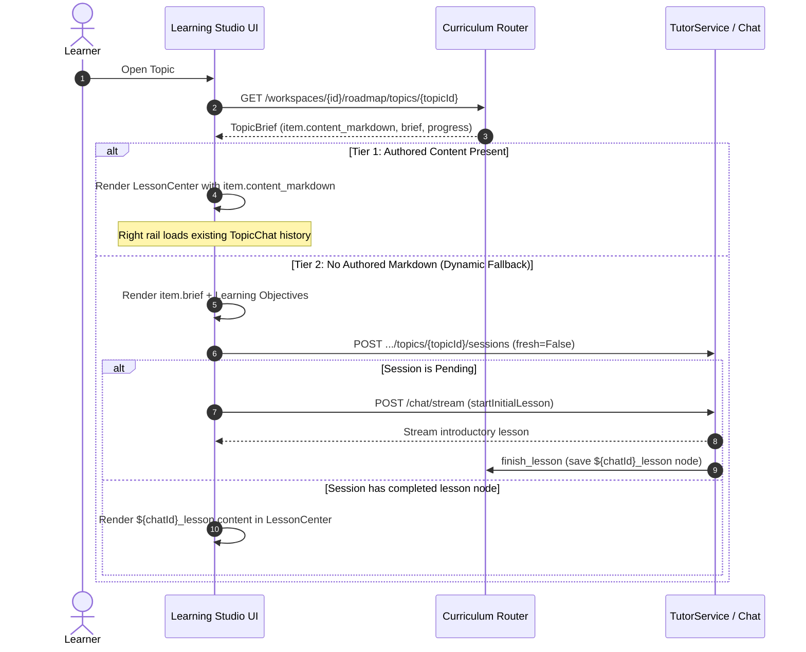

# LSI-002: Approve Integration Identity and Public Contracts

**Ticket:** LSI-002  
**Epic:** A (Foundation)  
**Type:** Architecture  
**Priority:** P0  
**Status:** DONE  
**Dependencies:** LSI-001  
**Approval Source:** User prompt approval ("ok") on 2026-10-15  
**Baseline Git Commit:** `aabb2d4`  

---

## 1. Executive Summary & Objective

This architectural specification defines the canonical data models, schemas, entity identities, lifecycle transitions, idempotency guarantees, authorization policies, and error behaviors required to integrate the Learning Studio with GraphMind's production backend.

In accordance with [LSI-002](file:///Users/balveerd/Documents/AI/GraphMind/docs/integration/LEARNING_STUDIO_BACKLOG.md#lsi-002-approve-integration-identity-and-public-contracts), this document establishes the boundary contracts between public guest-accessible resources and workspace-isolated learner records. It distinguishes existing endpoints from proposed additions, formalizes lesson body delivery, and provides concrete schemas and adversarial edge-case definitions prior to runtime implementation.

---

## 2. Entity Identity Specification

| Entity | Identity Format | Scope / Ownership | Mutability | Description |
| :--- | :--- | :--- | :--- | :--- |
| **Workspace** | `UUIDv4` (e.g. `123e4567-...`) | User / Tenant | Mutable | The top-level isolation and security boundary. All private assets belong to exactly one workspace. |
| **Public Template** | `templateId` (string, max 64) | Public | Immutable | Unique identifier of a curated curriculum (e.g. `roadmap-python-backend`). |
| **Public Snapshot** | `templateId + snapshotVersion` | Public | Immutable | Fixed version of a published roadmap (e.g. `roadmap-python-backend` @ `2026-10-14.1`). |
| **Enrollment / Personal Copy** | `roadmapId` (`UUIDv4`) | Workspace (`workspaceId`) | Mutable | Learner's saved copy of a template. Retains immutable `sourceSnapshotRef`. |
| **Curriculum Revision** | `revisionId` (`UUIDv4`) | Workspace (`workspaceId`) | Immutable | Immutable snapshot of curriculum items, phases, topics, order, and relations. |
| **Curriculum Topic** | `topicId` (slug string, max 64) | Curriculum Revision | Immutable | Stable topic identifier within a curriculum (e.g. `topic-fastapi-basics`). |
| **Root Chat** | `chatId` (`UUIDv4`) | Workspace (`workspaceId`) | Mutable | A conversation tree root node with `parentId = None`. |
| **Branch / Child Node** | `nodeId` (`UUIDv4`) | Workspace (`workspaceId`) | Immutable content | Message node under a root `chatId`. Has `parentId` and optional `highlightedContext` in metadata. |
| **TopicChat Session** | `sessionId` (`UUIDv4`) | Workspace (`workspaceId`) | Mutable | Associative record in `TopicChat` binding `workspaceId`, `topicId`, `revisionId`, and `chat_id`. |
| **Canvas Anchor** | `canvasAnchorChatId` (`UUIDv4`) | Workspace (`workspaceId`) | Stable | Dedicated chat root that anchors the curriculum's 2D canvas layout in the workspace graph. |

---

## 3. Public Domain Contracts (Guest & Discovery)

Public routes serve read-only template and snapshot data. They require **no authentication token** and **no workspace header**.

### 3.1 Public Catalog List
* **Endpoint:** `GET /api/v1/public/roadmaps`
* **Query Parameters:**
  * `query`: string (optional, search filter)
  * `category`: string (optional, e.g. `backend`, `frontend`, `ai`)
  * `level`: `beginner` | `intermediate` | `advanced` (optional)
  * `limit`: int (default 20, max 100)
  * `offset`: int (default 0)
* **Response Schema (`PublicRoadmapSummaryList`):**
  ```python
  class PublicRoadmapSummary(BaseModel):
      id: str = Field(..., max_length=64, description="Template identifier")
      slug: str = Field(..., max_length=64, description="URL-friendly slug")
      title: str = Field(..., max_length=180)
      summary: str = Field(..., max_length=2000)
      category: str = Field(..., max_length=64)
      level: Literal["beginner", "intermediate", "advanced"]
      estimated_weeks: int = Field(..., ge=1, le=104)
      hours_per_week: float = Field(..., ge=0.5, le=80.0)
      topic_count: int = Field(..., ge=1)
      snapshot_version: str = Field(..., max_length=32)
      tags: list[str] = Field(default_factory=list, max_length=20)
      updated_at: datetime

  class PublicRoadmapSummaryList(BaseModel):
      items: list[PublicRoadmapSummary]
      total: int
      limit: int
      offset: int
  ```

### 3.2 Public Roadmap Detail
* **Endpoint:** `GET /api/v1/public/roadmaps/{slug}`
* **Response Schema (`PublicRoadmapDetail`):**
  ```python
  class PublicTopicSummary(BaseModel):
      id: str
      slug: str
      title: str
      brief: str
      order: int
      path: Literal["core", "further"]
      estimate_minutes: int | None
      prerequisites: list[str] = Field(default_factory=list)

  class PublicPhaseDetail(BaseModel):
      id: str
      title: str
      order: int
      topics: list[PublicTopicSummary]

  class PublicSourceReference(BaseModel):
      id: str
      title: str
      url: HttpUrl | None = None
      locator: str | None = None
      kind: str

  class PublicRoadmapDetail(BaseModel):
      id: str
      slug: str
      title: str
      summary: str
      category: str
      level: Literal["beginner", "intermediate", "advanced"]
      snapshot_version: str
      outcomes: list[str]
      prerequisites: list[str]
      phases: list[PublicPhaseDetail]
      sources: list[PublicSourceReference]
  ```

### 3.3 Public Lesson Body
* **Endpoint:** `GET /api/v1/public/roadmaps/{slug}/topics/{topicSlug}`
* **Response Schema (`PublicLessonDetail`):**
  ```python
  class PublicLessonDetail(BaseModel):
      template_id: str
      snapshot_version: str
      topic_id: str
      topic_slug: str
      title: str
      brief: str
      objectives: list[str]
      content_markdown: str = Field(..., description="Complete authored lesson body")
      exercise: str | None = None
      format: Literal["concepts", "practice", "project"] | None = None
      estimate_minutes: int | None = None
      sources: list[PublicSourceReference] = Field(default_factory=list)
  ```

### 3.4 Security & Privacy Guarantees
1. **Zero Private Metadata Leakage:** Public DTOs omit `workspace_id`, `chat_id`, `session_id`, user IDs, personal notes, progress state, and draft messages.
2. **Neutral Error Responses:** Requesting an unpublished, drafted, or non-existent template returns a uniform `404 Not Found` with `{"detail": "Roadmap not found"}`.

---

## 4. Personal Learning Collection & Save-Copy Contract

Learners save public templates to their own workspaces to track progress and chat with the AI tutor.

### 4.1 Save-Copy Endpoint
* **Endpoint:** `POST /api/v1/workspaces/{workspaceId}/learning-roadmaps`
* **Mandatory Header:** `Idempotency-Key: <UUIDv4>`
* **Authorization:** Requires authenticated user session with write permission on `workspaceId`.
* **Request Schema (`SaveRoadmapCopyRequest`):**
  ```python
  class SaveRoadmapCopyRequest(BaseModel):
      template_id: str = Field(..., min_length=1, max_length=64)
      snapshot_version: str = Field(..., min_length=1, max_length=32)
      custom_title: str | None = Field(default=None, max_length=180)
  ```
* **Response Schema (`EnrollmentDetail`):**
  ```python
  class EnrollmentDetail(BaseModel):
      roadmap_id: str
      workspace_id: str
      revision_id: str
      source_snapshot_ref: str = Field(..., description="template_id:snapshot_version")
      title: str
      created_at: datetime
      updated_at: datetime
      topic_progress: dict[str, TopicProgressData] = Field(default_factory=dict)
  ```

### 4.2 Idempotency & Concurrency Rules
1. **Deduplication:** A workspace may enroll in a given template only once.
2. If `POST /learning-roadmaps` is called for an already enrolled `template_id`:
   - It returns the existing `EnrollmentDetail` with HTTP `200 OK` (or `201 Created` on initial insertion).
   - It does **not** create duplicate database rows or duplicate workspace canvas anchors.
3. If concurrent requests arrive with the same `Idempotency-Key`, the database unique constraint on `(workspace_id, source_template_id)` ensures atomicity via PostgreSQL `INSERT ... ON CONFLICT DO NOTHING`.

### 4.3 Collection Projection Endpoint
* **Endpoint:** `GET /api/v1/workspaces/{workspaceId}/learning-roadmaps`
* **Response Schema (`EnrollmentSummaryList`):**
  Returns all roadmaps saved or generated in the specified workspace, including aggregated completion percentages, total topics, and last activity timestamps.

---

## 5. Center Lesson Content: Architecture & Lifecycle

### 5.1 Backward-Compatible Schema Extension
To support rich authored lesson bodies while preserving full compatibility with the existing [`TopicBrief`](file:///Users/balveerd/Documents/AI/GraphMind/apps/api/src/schemas/curriculum.py#L176-L183) endpoint:
1. `CurriculumItemData` is extended with an optional field:
   ```python
   class CurriculumItemData(CurriculumSchema):
       # Existing fields (id, kind, title, brief, objectives, exercise, format, order, path, estimate_minutes, participation)...
       content_markdown: str | None = Field(default=None, max_length=65536)
   ```
2. For curated templates, `content_markdown` contains the complete lesson text.
3. For custom roadmaps generated without rich text, `content_markdown` is `None`.

### 5.2 Three-Tiered Content Lifecycle



---

## 6. Client Resumable Auth Intent Contract

When an unauthenticated guest attempts an action requiring an account (e.g. Save, Track Progress, Practice, Tutor), the client stores a transient intent in `localStorage`:

### 6.1 Discriminated Union Schema (`PendingAuthIntent`)
```typescript
export type PendingAuthIntent =
  | {
      kind: "save";
      templateId: string;
      snapshotVersion: string;
    }
  | {
      kind: "complete";
      templateId: string;
      topicId: string;
    }
  | {
      kind: "practice";
      templateId: string;
      topicId: string;
      activityVersion?: string;
    }
  | {
      kind: "tutor";
      templateId: string;
      topicId: string;
      quote?: string;
      sourceTextExcerpt?: string;
    }
  | {
      kind: "generator";
      initialProfile?: {
        title?: string;
        outcome?: string;
        level?: "beginner" | "intermediate" | "advanced";
        hoursPerWeek?: number;
      };
    };
```

### 6.2 Resumption Protocol & Security
1. **Single-Use Invariant:** Stored under key `graphmind:pending_auth_intent`. Immediately cleared from storage when reading upon login.
2. **Untrusted Payload Verification:** The server never blindly trusts the stored intent:
   - Validates that `templateId` and `topicId` exist in the active public catalog.
   - Requires verified session credentials and resolves the user's primary `workspaceId`.
   - Idempotently creates the enrollment if not present before applying the intent action.
3. **Graceful Fallback:** If the referenced template is no longer available or the user cancels sign-in, the UI discards the intent and remains on the current public view without error.

---

## 7. Generator Request Extensions

Extends the existing `RoadmapRequest` contract ([`roadmap_jobs.py`](file:///Users/balveerd/Documents/AI/GraphMind/apps/api/src/routers/roadmap_jobs.py)) without breaking existing clients:

```python
class RoadmapRequestExtended(RoadmapRequest):
    # Existing fields: title, prompt, level, background, duration, hoursPerWeek
    outcome: str | None = Field(default=None, max_length=2000, description="Specific measurable goal")
    known_skills: list[str] = Field(default_factory=list, max_length=50, description="Skills already mastered")
    reference_url: HttpUrl | None = Field(default=None, description="Optional reference documentation URL")
    sample_template_ref: str | None = Field(default=None, max_length=100, description="Seed template reference")
```

* **Idempotency:** `POST /api/v1/roadmap/jobs` continues to require a valid UUID `Idempotency-Key` header.
* **Cancellation Safety:** Calling `POST /api/v1/roadmap/jobs/{id}/cancel` halts processing; late background events cannot publish a curriculum or create workspace entities.

---

## 8. User Preferences and Data Export

1. **User Preferences (`GET/PUT /api/v1/users/me/preferences`):**
   - Stores `theme` (`light` | `dark` | `system`), `reading_font_size` (`sm` | `md` | `lg`), `reduced_motion` (`bool`), `default_study_hours` (`float`), `tutor_style` (`concise` | `socratic` | `detailed`).
   - Persisted in the database per authenticated user account; defaults applied when unauthenticated.
2. **Data Export (`GET /api/v1/workspaces/{workspaceId}/export`):**
   - Returns complete workspace JSON archive: enrollments, progress, chat message trees, branch quotes, and knowledge check attempts.
   - Excludes security tokens, provider credentials, and server system prompts.

---

## 9. Adversarial & Edge-Case Review

| Case | Threat / Risk | Mitigating Specification |
| :--- | :--- | :--- |
| **Cross-Workspace Access** | User requests `/workspaces/{wsB}/learning-roadmaps` with token for `wsA`. | `WorkspaceDependency` strictly verifies user membership in target workspace; returns `404 Not Found` (neutral, no information leak). |
| **Concurrent Duplicate Save** | Two browser tabs submit `save` for the same template simultaneously. | Database unique constraint on `(workspace_id, source_snapshot_ref)` + `Idempotency-Key` ensures exactly one enrollment is created. |
| **Stale Snapshot Reference** | Learner attempts to save a deprecated or unpublished snapshot. | Server validates against active `public_snapshots` table; returns `400 Bad Request` with `{"detail": "Template snapshot version is obsolete"}`. |
| **Hostile Branch Quote** | Client sends a `highlightedContext.quote` not present in source text. | Server validates substring inclusion of `quote` in the referenced parent node before persisting branch node. |
| **Tampered Auth Intent** | Malicious intent tries to execute an action on an unowned workspace. | Intent carries only public template/topic IDs; target workspace is derived exclusively from server-side authenticated session. |

---

## 10. Acceptance & Review Verification
- **Compatibility:** All proposed contracts extend existing schemas additively; no existing route or database column is broken.
- **Contract Boundary:** Existing endpoints vs. proposed additions are explicitly demarcated.
- **Evidence Ready:** Complete specification ready for downstream implementation in tickets LSI-003 through LSI-032.
